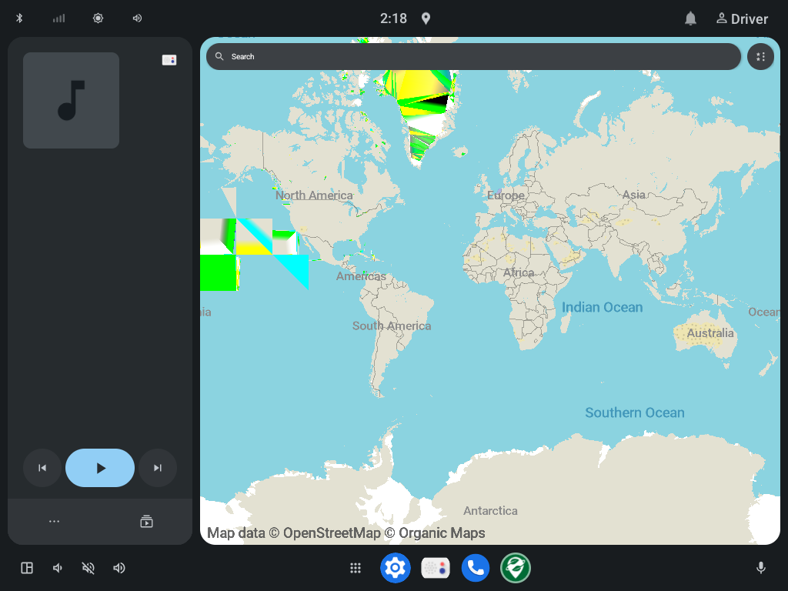
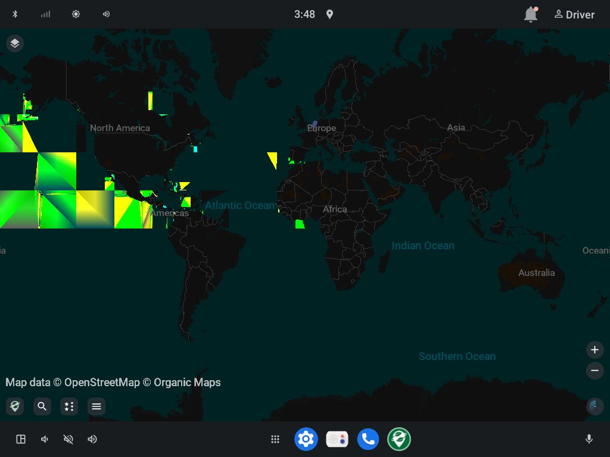
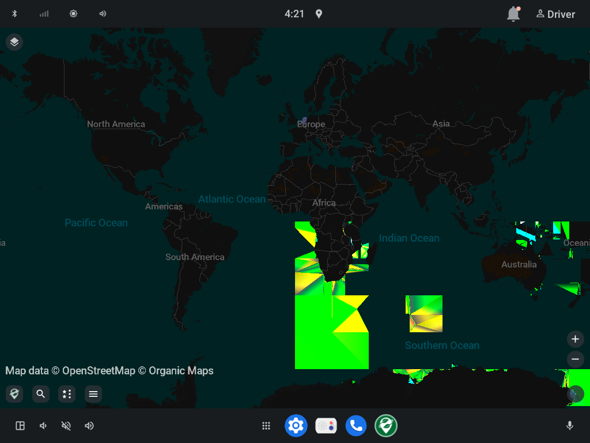
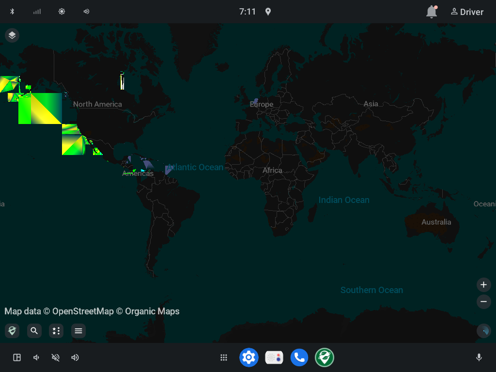
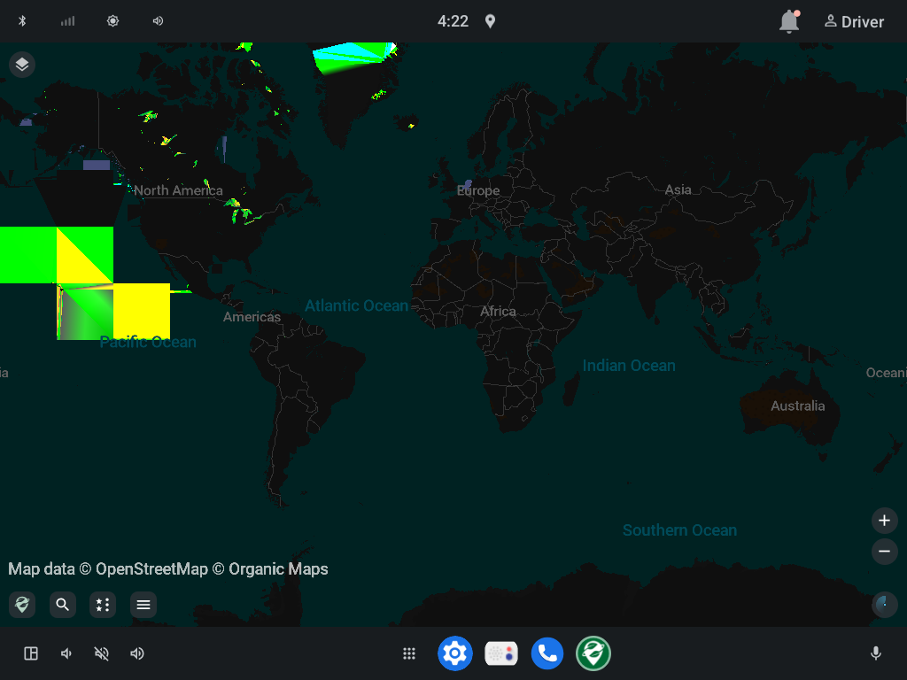
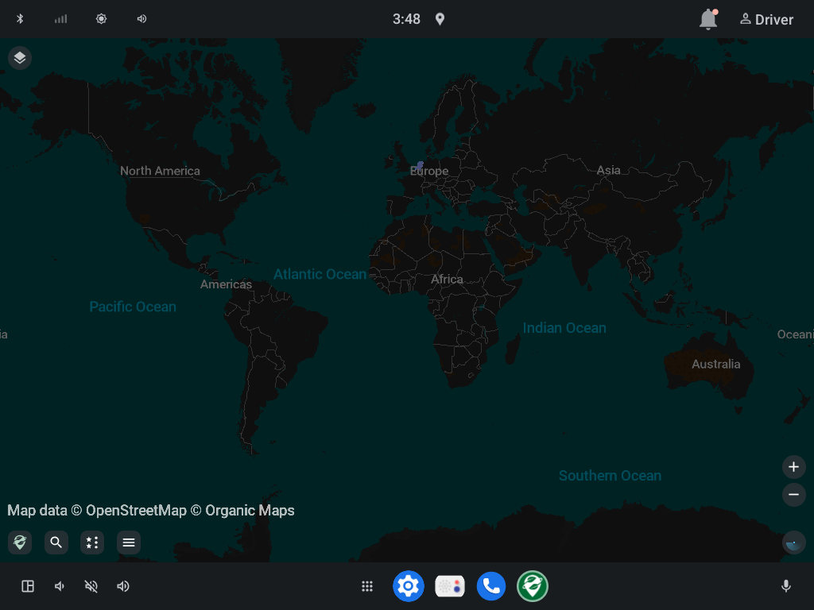

# AAOS: corrupted map geometry on first launch

Large garbage triangles (yellow/green/cyan, or the style's accent colours) over world-level geometry — Pacific,
coasts of the Americas, Antarctica — the first time the app renders after its settings are fresh. The next launch
renders the same data cleanly.

| First launch, map card (GL) | First launch, full app (GL) | First launch, ANGLE on Vulkan |
|---|---|---|
|  |  |  |

| First launch, Mesa 25.3 GL | First launch, map card disabled | Second launch (clean) |
|---|---|---|
|  |  |  |

## Reproduction (Khadas VIM3, LineageOS 23.2 AAOS, driver user 10)

```sh
adb shell 'am force-stop --user 10 app.organicmaps; rm -f /data/user/10/app.organicmaps/files/settings.ini'
adb shell am start --user 10 -n app.organicmaps/app.organicmaps.MwmActivity
sleep 7; adb exec-out screencap -p > shot.png
```

Intermittent: roughly 25–80 % of runs. Map data: World, WorldCoasts and the 24 Netherlands files of version
260714 in `/data/media/10/Android/data/app.organicmaps/files/260714/`. On a fresh start the app first fails to load
`assets/World.mwm` / `assets/WorldCoasts.mwm`, then uses the files above.

## What has been ruled out (on the VIM3)

Each still shows the corruption:

- Every Mesa 26.2 GL build since 2026-09-25, and Mesa 25.3.0-rc4 (older compiler generation).
- ANGLE on the panvk Vulkan driver instead of Mesa GL (a different GL implementation).
- Kernel panfrost uapi 1.3 and 1.6.
- `MapCardActivity` disabled (`pm disable`), so no card ⇄ app surface handoff.
- `PAN_MESA_DEBUG=sync` (every GPU job waited for). `nocache` (fresh GPU buffers) makes it more frequent.

Clearing only the shader cache does **not** bring it back; deleting `settings.ini` does. So the trigger is the app's
first-launch state, and the GPU stack is not the cause.

## Hypothesis: our AAOS changes

The fork is two commits on upstream `cad9654`:

- `c3c7cca` [android] Add explicit map surface detach/attach to MapController
  (`MapController.detachSurface()` / `attachSurface()`).
- `8e63d0a` [android] Add an Android Automotive map card for the car launcher. In `MwmActivity`, on AAOS:
  - `onStart()`: if `isCarDisplayUsed()` → hide the map view and `changeDisplay(DisplayType.Device)`;
  - `onDisplayChangedToDevice()`: show the view, **`attachSurface()`**, then `processIntent()`;
  - `onDisplayChangedToCar()`: `Automotive.releaseMap()` instead of finishing.

Prime suspect: on a fresh launch the explicit `attachSurface()` can run in addition to the regular
`surfaceCreated` path, so the engine gets `onSurfaceCreated()` twice (or a detach/attach while the first tiles are
being built). Recreating the drape surface/context while the backend renderer still uploads the first tiles would
leave it drawing stale or reused geometry buffers — which matches corruption that only appears while the first tiles
of the (just switched) world data are built. These paths run even with the card disabled.

## Test plan (cloud task, known-good emulator)

Goal: show whether the corruption comes from our commits, and from which part, on a GPU stack that is known good.

### Setup

1. Emulators, both x86_64 with a working GPU (host GPU / gfxstream; SwiftShader as second opinion):
   - **AAOS**: Android Automotive system image (API 34+, `automotive` 1024p landscape), so
     `Automotive.isAutomotive()` is true and the car paths run.
   - **Phone**: a regular API 34+ image, as a control where our AAOS paths are inactive.
2. Map data: let the app download World/WorldCoasts and one small country (e.g. Luxembourg), or push version 260714
   files into `Android/data/app.organicmaps/files/<version>/` (see `adb` layout above). Use the same data for all runs.
3. Builds (`android/`, `./gradlew assembleFdroidDebug`, x86_64 ABI):
   - **A** upstream `cad9654` (no changes),
   - **B** `c3c7cca` (surface API only — no callers, should behave like A),
   - **C** `8e63d0a` (branch head, with the card and the `MwmActivity` changes).

### Measurement

Per build and emulator, 10 runs of the reproduction above (the user id is 0 on a phone emulator; on AAOS the driver
user is usually 10). Screenshot after 7 s, and a reference screenshot of the second launch. Score = number of pixels
differing strongly from the reference outside the UI controls (or, for the dark style, the pixel count with
g>200, b<80 and r>200 or r<80, which is 0 on clean frames and hundreds to tens of thousands on corrupt ones; ~20 is
noise from a small green UI element).

### Decision

| A | C | Conclusion | Next |
|---|---|---|---|
| clean | corrupt (AAOS) | our changes | narrow down in C (below) |
| corrupt | corrupt | upstream bug | reproduce on phone emulator, report upstream |
| clean | clean | not reproducible on emulator | run A on the VIM3 — then it is device-specific after all |

### Narrowing down inside `8e63d0a` (if C corrupts and A doesn't)

One change at a time, 10 runs each on the AAOS emulator:

1. `onDisplayChangedToDevice()`: drop `mMapController.attachSurface()` (rely on `surfaceCreated`).
2. `onStart()`: skip the `isCarDisplayUsed() && isAutomotive` branch (no `View.GONE` + `changeDisplay`).
3. Force `Automotive.isAutomotive()` to false (all AAOS paths off) — should match A.
4. Log every `Map.onSurfaceCreated/onSurfaceDestroyed` call with thread and caller on first launch; a double
   `onSurfaceCreated` without a destroy in between would confirm the hypothesis.

Fix direction if confirmed: make `attachSurface()` a no-op unless the surface was detached by `detachSurface()`
(track that explicitly instead of `isSurfaceAttached()`), and only switch displays once the first surface exists.

### Done when

- Root cause identified with the logs from step 4 (or equivalent).
- Fix on `aaos-map-provider`, 10/10 clean first launches on the AAOS emulator, card ⇄ app handoff still working
  (card → search → full app → home → card shows the map again).
- Then verified on the VIM3 with the repro above (10 runs).
